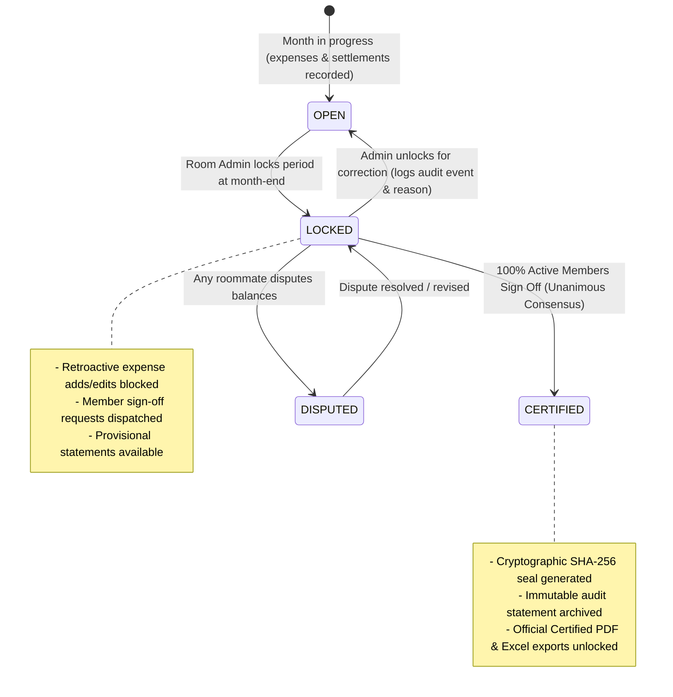

# Implementation Plan: Track 4 — Monthly Room Ledger Audit & Certified Statement Export

## 📋 Executive Overview

**Track 4** delivers an enterprise-grade financial closing, reconciliation, and audit reporting engine for RoomMate. In shared apartments and student housing, end-of-month settlements frequently lead to disputes due to retroactive modifications, unacknowledged offline payments, and lack of signed agreements. 

This plan implements:
1. **Monthly Reconciliation Lock**: Allows Room Admins to close and lock historical monthly accounting cycles, preventing retroactive addition, modification, or deletion of shared expenses and settlements without audited administrative unlock.
2. **Room Financial Sign-off & Consensus State Machine**: All active roommates review their point-in-time net positions, splits, and settlements, with a unanimous sign-off workflow (all members must sign off to certify the statement).
3. **Certified Statement Cryptographic Sealing**: Generates a tamper-evident SHA-256 statement seal hash once 100% consensus is achieved, unlocking an official "Certified Statement" badge.
4. **Downloadable Certified PDF & Multi-Sheet Excel (.xlsx) Reports**: High-fidelity, beautifully formatted audit reports featuring digital signatures, reconciliation badges, canonical V2 net positions, min-cash-flow settlement recommendations, and full transaction trails.
5. **Universal Cross-Platform Local Storage File Saver**: Guarantees that any download command executed on Web or Native Mobile (Capacitor Android APK / iOS) actually writes the binary file to the device's physical storage (`Downloads`/`Documents`) with in-app confirmation and native share/open capabilities.

---

## 🎯 Architecture & State Machine



---

## 📱 Socratic Gate Clarifications & User Decisions

During the Phase 0 Socratic Gate, the following architectural choices were approved:
- **Consensus Rule**: **Unanimous Sign-off** — All active room members must explicitly click "Approve & Sign Statement", with live progress (e.g. "3 of 4 Signed") and auto-transition to "Certified" upon 100% signature completion.
- **Lock Enforcement**: **Strict Audit Lock with Admin Override** — Past periods are hard-locked from edits/adds. Any required correction mandates an explicit Room Admin unlock accompanied by a mandatory audit reason and an incremented revision count.
- **Mobile Local Storage Guarantee**: **Native Filesystem + Share Sheet** — On Capacitor Android APK / iOS, files are directly written to physical storage via `@capacitor/filesystem`, confirmed via in-app toast, and surfaced via `@capacitor/share` or file open triggers. On web browsers, RFC-compliant Blob downloads with strict MIME headers and UTF-8 BOM encoding are enforced.

---

## 🗄️ Database & Schema Design

### 1. Migration: `20261031120000_room_reconciliation_lock_and_statements.sql`

#### Table: `public.room_reconciliation_periods`
```sql
CREATE TABLE public.room_reconciliation_periods (
  id UUID PRIMARY KEY DEFAULT gen_random_uuid(),
  room_id UUID NOT NULL REFERENCES public.rooms(id) ON DELETE CASCADE,
  period_year INT NOT NULL CHECK (period_year >= 2024 AND period_year <= 2100),
  period_month INT NOT NULL CHECK (period_month >= 1 AND period_month <= 12),
  status TEXT NOT NULL DEFAULT 'OPEN' CHECK (status IN ('OPEN', 'LOCKED', 'CERTIFIED')),
  locked_at TIMESTAMPTZ,
  locked_by UUID REFERENCES public.profiles(id),
  unlocked_at TIMESTAMPTZ,
  unlocked_by UUID REFERENCES public.profiles(id),
  unlock_reason TEXT,
  revision_count INT NOT NULL DEFAULT 1,
  certified_at TIMESTAMPTZ,
  certified_seal_hash TEXT, -- SHA-256 signature of canonical financial snapshot
  created_at TIMESTAMPTZ NOT NULL DEFAULT clock_timestamp(),
  updated_at TIMESTAMPTZ NOT NULL DEFAULT clock_timestamp(),
  CONSTRAINT uq_room_period UNIQUE (room_id, period_year, period_month)
);
```

#### Table: `public.room_statement_signoffs`
```sql
CREATE TABLE public.room_statement_signoffs (
  id UUID PRIMARY KEY DEFAULT gen_random_uuid(),
  period_id UUID NOT NULL REFERENCES public.room_reconciliation_periods(id) ON DELETE CASCADE,
  room_id UUID NOT NULL REFERENCES public.rooms(id) ON DELETE CASCADE,
  user_id UUID NOT NULL REFERENCES public.profiles(id) ON DELETE CASCADE,
  status TEXT NOT NULL DEFAULT 'PENDING' CHECK (status IN ('PENDING', 'SIGNED', 'DISPUTED')),
  signed_at TIMESTAMPTZ,
  dispute_reason TEXT,
  signature_stamp TEXT, -- JSON/HMAC stamp of member snapshot balance at sign time
  created_at TIMESTAMPTZ NOT NULL DEFAULT clock_timestamp(),
  updated_at TIMESTAMPTZ NOT NULL DEFAULT clock_timestamp(),
  CONSTRAINT uq_period_user_signoff UNIQUE (period_id, user_id)
);
```

#### RLS & Database Guard Trigger
1. **Mutation Guard Trigger (`trg_guard_locked_room_period`)**:
   - Attached to `public.shared_expenses` (`INSERT`, `UPDATE`, `DELETE`) and `public.settlement_payments` (`INSERT`, `UPDATE`, `DELETE`).
   - Checks if the record's `expense_date` (or `payment_date`) falls within a `LOCKED` or `CERTIFIED` period for that `room_id`.
   - If locked, raises exception: `PERIOD_LOCKED: Cannot modify transactions for <Month YYYY> because reconciliation is locked.`
2. **Secure RPCs**:
   - `public.lock_room_reconciliation_period_v2(p_room_id UUID, p_year INT, p_month INT)`: Room Admin locks period, initializes sign-off rows for all active members.
   - `public.unlock_room_reconciliation_period_v2(p_room_id UUID, p_year INT, p_month INT, p_reason TEXT)`: Room Admin unlocks period, logs audit log, increments revision count.
   - `public.sign_room_statement_v2(p_period_id UUID, p_action TEXT, p_reason TEXT)`: Member marks `SIGNED` or `DISPUTED`. If 100% active members sign, atomically calculates SHA-256 seal hash and transitions status to `CERTIFIED`.
   - `public.get_room_reconciliation_statement_v2(p_room_id UUID, p_year INT, p_month INT)`: Returns authoritative snapshot (expenses, splits, settlements, canonical V2 balances, sign-off status, and seal hash).

---

## 💾 Native & Web File Download Architecture (`fileDownloadService.ts`)

### Why Existing Downloads Fail on Mobile
In standard web apps, developers invoke:
```ts
const url = URL.createObjectURL(blob);
const a = document.createElement('a');
a.href = url;
a.download = filename;
a.click();
```
When running inside an **Android WebView** (Capacitor APK), WebView does NOT route `blob:` URL anchor clicks to Android's native `DownloadManager`. The click is either ignored or generates an untrapped navigation event, meaning **no file is saved to the user's phone storage**.

### The Guaranteed Universal Solution
Create `src/lib/services/fileDownloadService.ts`:

1. **Environment Detection**:
   - Checks `Capacitor.isNativePlatform()` (Android / iOS) vs standard Web Browser.
2. **Native Mobile Flow (Capacitor Android / iOS)**:
   - Convert `Blob` to Base64 string via `FileReader` / `Uint8Array`.
   - Install and utilize `@capacitor/filesystem`:
     ```ts
     const writeResult = await Filesystem.writeFile({
       path: `Download/${filename}`,
       data: base64Data,
       directory: Directory.Documents, // or Directory.Downloads on Android
       recursive: true
     });
     ```
   - Trigger native confirmation toast displaying the exact destination:
     `"Saved to Documents: <filename>"`
   - Use `@capacitor/share` to provide an immediate system action sheet (Open with PDF viewer / Excel, Save to Files, or Share via WhatsApp).
3. **Web Browser Flow**:
   - Create Blob with exact RFC MIME types:
     - PDF: `application/pdf`
     - Excel: `application/vnd.openxmlformats-officedocument.spreadsheetml.sheet`
     - CSV: `text/csv;charset=utf-8` (with `\uFEFF` UTF-8 BOM prepended to preserve Indian Rupee symbol `₹`).
   - Trigger click with proper DOM attachment and delayed URL revocation (`setTimeout 1000ms`).
4. **File Format Integrity Validation**:
   - PDF validator: Verifies `%PDF-1.` magic bytes.
   - Excel validator: Verifies PKZip header `PK\x03\x04`.

---

## 📑 Certified Statement Report Specifications

### 1. Certified PDF Audit Report (`roomExpenseExportPdf.ts`)
- **Branded Executive Header**:
  - Official RoomMate emblem, Room Name, Reconciliation Period (`October 2026`).
  - Statement Status Pill: 
    - `[CERTIFIED STATEMENT]` (Deep Emerald `#059669` + Seal Icon)
    - `[PROVISIONAL — PENDING SIGN-OFF]` (Amber `#D97706`)
  - Cryptographic Seal Hash: Formatted SHA-256 fingerprint (`SEAL: a4f9e1...`).
- **Room Financial Sign-off Grid**:
  - Table of all roommates with:
    - Member Name & Avatar
    - Role (`Room Admin` / `Roommate`)
    - Sign-Off Status (`CERTIFIED & SIGNED` / `PENDING REVIEW`)
    - Timestamp & Verification Stamp
- **Canonical V2 Financial Position Box**:
  - Total Room Spend in period
  - Member breakdown: Gross Spent, Fair Share Allocated, Total Settlements Paid, Final Net Balance (Paise-accurate).
- **Acyclic Min-Cash-Flow Optimal Transfers**:
  - Plain-English settlement guide: `"Priya pays Rahul ₹450.00 to fully square October balances"`.
- **Itemized Ledger Tables**:
  - Table A: Shared Expenses (Date, Description, Category, Paid By, Split Method, Total Amount).
  - Table B: Confirmed Settlements (Date, Payer, Payee, Amount, Method, Status, UTR/Proof).
- **Legal & Audit Disclaimer Footer**:
  - Generated timestamp, active member count, and mathematical zero-sum verification (`Sum of Net Balances = ₹0.00`).

### 2. Certified Multi-Sheet Excel Workbook (`roomExpenseExportXlsx.ts`)
- **Sheet 1: `Audit_Summary`**:
  - Room details, Period, Status, Certified Date, SHA-256 Seal Hash.
  - Member Sign-Off Roster (Member, Email, Status, Signed At).
- **Sheet 2: `Net_Positions`**:
  - Columns: Roommate, Total Paid (₹), Fair Share (₹), Net Position (₹), Status (`Owes` / `Receives` / `Settled`).
  - Optimal min-cash-flow transfer instructions.
- **Sheet 3: `Shared_Expenses`**:
  - Columns: Expense ID, Date, Title, Category, Paid By, Total Amount, Participant Count, Split Method, Notes.
- **Sheet 4: `Settlement_Trail`**:
  - Columns: Settlement ID, Date, Payer, Payee, Amount, Method, Status, Confirmation Type, Evidence UTR.

---

## 🔨 Step-by-Step Implementation Breakdown

### Phase 1: Storage & Native Toolchain Dependencies (P0)
- **Task 1.1**: Install `@capacitor/filesystem` and `@capacitor/share` in `package.json`.
- **Task 1.2**: Implement `src/lib/services/fileDownloadService.ts` with cross-platform detection, Base64 conversion, native filesystem writing, share sheet trigger, and format magic-byte validation.
- **Verify**: Run Vitest test mocking both Capacitor native platform and web environment; ensure file byte streams and downloads succeed.

### Phase 2: Database Schema & Secure RPCs (P0)
- **Task 2.1**: Author migration `supabase/migrations/20261031120000_room_reconciliation_lock_and_statements.sql`.
- **Task 2.2**: Implement tables `room_reconciliation_periods`, `room_statement_signoffs`.
- **Task 2.3**: Implement database mutation guard trigger preventing modifications during locked/certified periods.
- **Task 2.4**: Implement RPCs `lock_room_reconciliation_period_v2`, `unlock_room_reconciliation_period_v2`, `sign_room_statement_v2`, and `get_room_reconciliation_statement_v2`.
- **Verify**: Apply migration on local/staging database; test RPC permissions and trigger locking.

### Phase 3: Client Adapters & State Management (P1)
- **Task 3.1**: Add TypeScript interfaces (`RoomReconciliationPeriod`, `RoomStatementSignoff`, `ReconciliationStatementDataset`) in `src/types/index.ts`.
- **Task 3.2**: Implement `src/lib/storage/reconciliationAdapter.ts` with Supabase fetch, lock, unlock, sign-off, and offline cache fallbacks.
- **Task 3.3**: Integrate live Supabase Realtime subscription on `room_reconciliation_periods` and `room_statement_signoffs` for instant UI updates when roommates sign.
- **Verify**: Unit tests verifying state transitions and unanimous consensus calculations.

### Phase 4: Certified Report Generators (PDF & Excel) (P2)
- **Task 4.1**: Upgrade `src/lib/services/roomExpenseExportPdf.ts` to render the Certified Statement layout, sign-off roster, SHA-256 seal badge, and V2 canonical balances.
- **Task 4.2**: Upgrade `src/lib/services/roomExpenseExportXlsx.ts` to output the 4-sheet certified workbook.
- **Task 4.3**: Wire both generators to `fileDownloadService.ts` for guaranteed local storage saves.
- **Verify**: Automated test generating sample PDF and XLSX buffers; verify `%PDF-` and `PK\x03\x04` signatures.

### Phase 5: Room Ledger UI & Sign-Off Experience (P2)
- **Task 5.1**: Build `src/components/reconciliation/RoomReconciliationCard.tsx` for desktop and mobile Room Ledger views.
- **Task 5.2**: Build `src/components/reconciliation/StatementSignOffModal.tsx`: Roommates review monthly net position, view itemized breakdown, and submit digital sign-off or dispute.
- **Task 5.3**: Build `src/components/reconciliation/AdminLockPeriodModal.tsx` and `AdminUnlockModal.tsx`.
- **Task 5.4**: Integrate into `RoomLedger.tsx` and `MobileRoomLedger.tsx` with month picker and download buttons ("Download Certified PDF" / "Download Certified Excel").
- **Verify**: Visual and UX check in desktop and mobile viewports.

---

## 🔍 Phase X: Verification & Quality Checklist

| # | Check | Verification Method | Expected Result |
|---|---|---|---|
| 1 | **Database Migration Syntax** | `npm test` & PostgreSQL parser | Migration applies cleanly with zero RLS warnings |
| 2 | **Strict Period Lock Trigger** | Insert expense into locked period via SQL | Blocked with `PERIOD_LOCKED` error |
| 3 | **Unanimous Consensus Rule** | Simulate 3/4 member sign-offs | Status remains `LOCKED`; on 4th sign-off transitions to `CERTIFIED` with SHA-256 seal |
| 4 | **Admin Unlock Audit Trail** | Room Admin unlocks period | Revision count increments, audit log entry created, status reverts to `OPEN` |
| 5 | **PDF Format & Integrity** | Generate statement PDF | Valid `%PDF-` header, watermark, sign-off grid, and ₹ paise-perfect totals |
| 6 | **Excel Format & Integrity** | Generate statement XLSX | Valid `PK\x03\x04` ZIP header, 4 distinct sheets, correct formatting |
| 7 | **Mobile Download to Local Storage** | Invoke download in Capacitor environment | `@capacitor/filesystem` writes file to `Documents/Downloads`, toast confirms path, share sheet triggers |
| 8 | **Web Browser Download** | Invoke download on Chrome/Firefox | File downloads to user's browser download folder with correct filename and extension |
| 9 | **Build & TypeScript Integrity** | `npm run build` | Clean compilation with zero TypeScript errors (`tsc -b`) |

