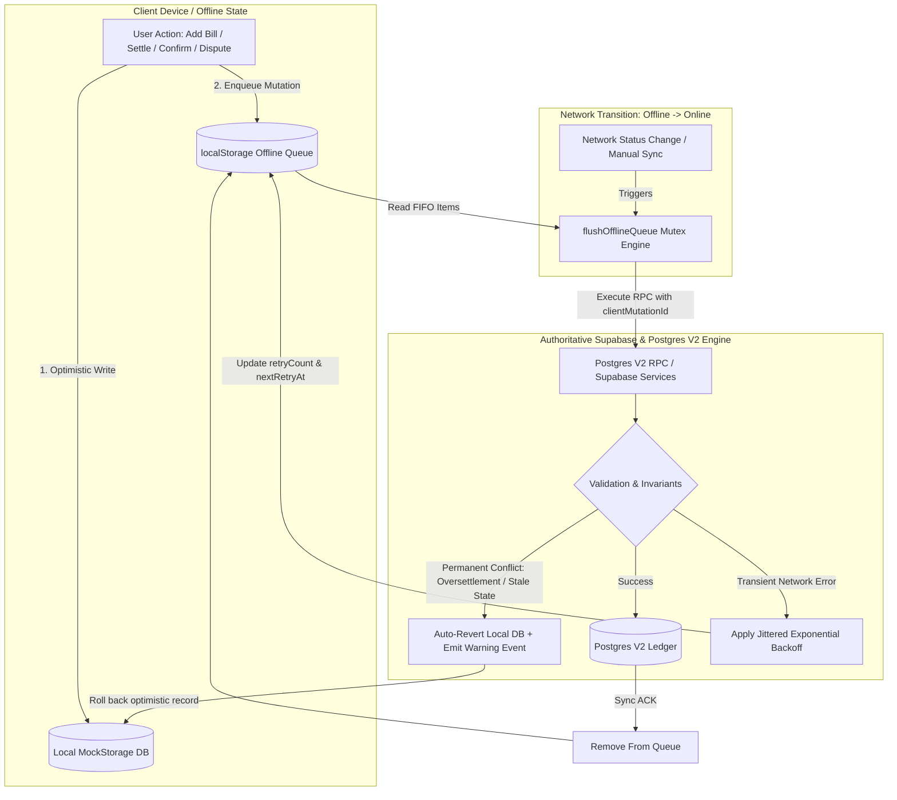

# Implementation Plan: Track 3 — Offline Mutation Queue & Edge-Case Replay Hardening

## 📋 Executive Overview

**Track 3** establishes an enterprise-grade offline-first mutation engine for RoomMate. In student hostels, campus basements, metro transit, and areas with spotty network coverage, roommates must be able to record shared expenses, claim settlements, confirm payments, dispute transactions, and submit UTR evidence without seeing frustrating error modals or losing uncommitted financial entries.

This plan hardens the existing `offlineQueue` system to achieve:
1. **Full Lifecycle Offline Optimism**: Extending offline mutation types to cover all settlement state machine actions (`CONFIRM_SETTLEMENT`, `DISPUTE_SETTLEMENT`, `CANCEL_SETTLEMENT`, `SUBMIT_SETTLEMENT_EVIDENCE`).
2. **Authoritative Conflict Resolution & Auto-Reversion**: If an offline settlement or transaction fails permanently on replay due to concurrent server state changes (e.g. debt already settled by cash, resulting in `OVERSETTLEMENT_EXCEEDS_DEBT`), the queue automatically discards the mutation, rolls back the local optimistic record in `mockStorage`, emits an auditable event, and alerts the user with an actionable warning toast.
3. **Jittered Exponential Backoff & Circuit Breaker**: Transient network errors (HTTP 503, timeouts, offline blips) use exponential backoff ($1.5s, 3s, 6s, 12s, \le 15s$) with random jitter ($\pm 500\text{ ms}$) and a 5-attempt ceiling, preventing network hammering and conserving mobile battery.
4. **Idempotency & Deduplication**: Every queued mutation retains an immutable `clientMutationId` and `localId`, guaranteeing that concurrent flushes or repeated network deliveries never produce duplicate financial rows.

---

## 🎯 Architecture & Data Flow

---

## 🛠️ Step-by-Step Implementation Breakdown

### Phase 1: Offline Queue Types & Payload Expansion (`src/lib/storage/offlineQueue.ts`)
1. Extend `OfflineMutationType`:
   - Add `'CONFIRM_SETTLEMENT'`
   - Add `'DISPUTE_SETTLEMENT'`
   - Add `'CANCEL_SETTLEMENT'`
   - Add `'SUBMIT_SETTLEMENT_EVIDENCE'`
2. Add type interfaces:
   - `ConfirmSettlementPayload`: `{ settlementId: string; userId: string; roomId: string; }`
   - `DisputeSettlementPayload`: `{ settlementId: string; userId: string; roomId: string; reason: string; }`
   - `CancelSettlementPayload`: `{ settlementId: string; userId: string; roomId: string; }`
   - `SubmitSettlementEvidencePayload`: `{ settlementId: string; userId: string; roomId: string; utr: string; evidenceUrl?: string; }`
3. Add `nextRetryAt?: number` to `OfflineQueueItem`.

### Phase 2: Replay Execution & Jittered Backoff Engine
1. Inside `flushOfflineQueue`:
   - Filter items whose `nextRetryAt && nextRetryAt > Date.now()` (skip until backoff elapses).
   - Add handlers for the 4 new mutation types:
     - `CONFIRM_SETTLEMENT`: `supabaseService.confirmRoomSettlement(data.settlementId)`
     - `DISPUTE_SETTLEMENT`: `supabaseService.disputeRoomSettlement(data.settlementId, data.reason)`
     - `CANCEL_SETTLEMENT`: `supabaseService.cancelRoomSettlement(data.settlementId)`
     - `SUBMIT_SETTLEMENT_EVIDENCE`: `supabaseService.submitSettlementEvidence(data.settlementId, data.utr, data.evidenceUrl)`
2. Backoff Calculation:
   - Base delay: `Math.min(15000, 1500 * Math.pow(2, item.retryCount)) + Math.floor(Math.random() * 500)`
   - Max retries: 5 attempts. If `item.retryCount >= 5` on transient errors, flag as stalled.
3. Conflict Auto-Revert:
   - When permanent conflict occurs (`OVERSETTLEMENT`, `PAYER_IS_NOT_A_DEBTOR`, `INVALID_SETTLEMENT`, 404/PGRST116, RLS 42501, FK 23503):
     - If `type === 'RECORD_SETTLEMENT'` and `localSettlementId` is present:
       - Roll back the local settlement from `db` (`db.deleteSettlementPayment` or revert status).
     - If `type === 'CONFIRM_SETTLEMENT'` or `'DISPUTE_SETTLEMENT'`:
       - Refresh/re-read true settlement state from server or restore previous status.
     - Dispatch `roommate_sync_conflict_discarded` event with payload `{ itemId, type, error, localSettlementId, roomId }`.

### Phase 3: Cloud Storage Adapter Offline Fallback Integration (`src/lib/storage/cloudStorageAdapter.ts`)
1. Wrap `confirmSettlementCloud`, `disputeSettlementCloud`, `cancelSettlementCloud`, and `submitSettlementEvidenceCloud` in graceful network detection:
   - Check if offline (`!navigator.onLine || isSimulatedOfflineMode()`) or if Supabase call catches a network error (`isNetworkError(err)`).
   - If offline:
     - Apply optimistic mutation in local `db`.
     - Call `enqueueOfflineItem(type, payload)`.
     - Return the optimistic local settlement.

### Phase 4: App Notification & UI Conflict Handler (`src/App.tsx`)
1. Add an event listener for `roommate_sync_conflict_discarded`:
   - Surface an urgent warning toast: e.g., `"⚠️ Offline settlement reverted: debt balance changed while offline"`.
   - Trigger `fetchCloudDatabaseState().then(setDbState)` to instantly refresh the UI to the canonical cloud ledger.

### Phase 5: Verification & Comprehensive Test Suite
1. Create `src/test/offline-queue/offlineReplayHardening.test.ts` covering:
   - `OQ-1`: Enqueues and replays `CONFIRM_SETTLEMENT` upon reconnection.
   - `OQ-2`: Enqueues and replays `DISPUTE_SETTLEMENT` upon reconnection.
   - `OQ-3`: Enqueues and replays `CANCEL_SETTLEMENT` upon reconnection.
   - `OQ-4`: Enqueues and replays `SUBMIT_SETTLEMENT_EVIDENCE` upon reconnection.
   - `OQ-5`: Reverts local settlement and dispatches warning event when server rejects with `OVERSETTLEMENT_EXCEEDS_DEBT`.
   - `OQ-6`: Reverts local settlement and dispatches warning event when server rejects with `PAYER_IS_NOT_A_DEBTOR`.
   - `OQ-7`: Enforces exponential backoff and skips items during backoff delay.
   - `OQ-8`: Handles network drop during `confirmSettlementCloud` by queueing and optimistically updating local DB.
2. Run full test suite (`vitest run`).
3. Run linter (`oxlint src`).
4. Run production build (`npm run build:prod`).

