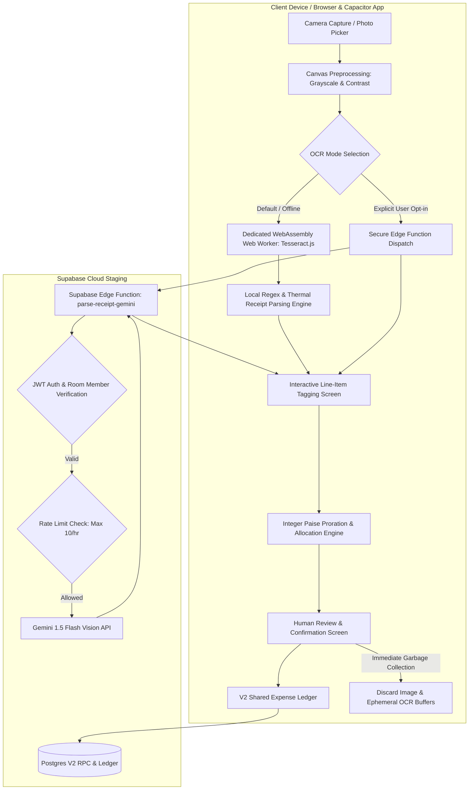
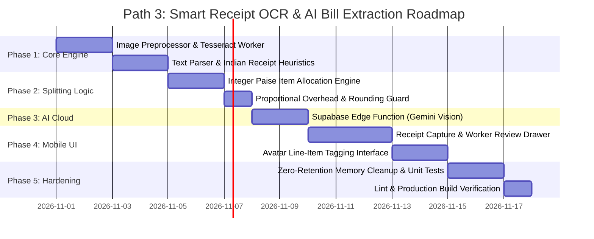

# Implementation Plan: Smart Receipt OCR & AI Bill Extraction

## 📋 Executive Overview

**Path 3: Smart Receipt OCR & AI Bill Extraction** automates expense logging and bill splitting for shared apartments, student flats, and hostel dhabas. Instead of manually typing individual grocery lists, electricity bills, or restaurant orders, roommates can capture a photo of any receipt, extract line items, taxes, and discounts, and interactively assign specific items to the roommates who consumed them.

This plan establishes a **Dual-Hybrid Architecture**:
1. **Default On-Device OCR**: Privacy-first, zero-cost, offline-capable optical text recognition using **Tesseract.js** running in a dedicated background **Web Worker** to guarantee zero UI stutter.
2. **Serverless AI Enhancement**: Optional high-accuracy extraction via a secure **Supabase Edge Function** (`parse-receipt-gemini`) leveraging Gemini 1.5 Flash Vision for messy handwriting, unformatted mess tokens, and complex multi-tax breakdowns.
3. **Interactive Line-Item Tagging**: An intuitive mobile review interface allowing users to tap roommate avatars on individual items, with **proportional tax, delivery, and discount proration**.
4. **Transient Zero-Retention Storage**: Strict privacy posture where receipt photos and raw image buffers are processed strictly in memory and discarded immediately upon expense confirmation.
5. **Exact Integer Paise Reconciliation**: Zero float drift with mathematical remainder distribution, ensuring the sum of all individual liabilities matches the receipt total to the exact paise.

---

## 🎯 Architecture & Data Flow



---

## 🗄️ Database & Schema Design

### 1. Zero Breaking Changes Policy
To preserve compatibility with existing Postgres V2 functions (`record_room_settlement_v2`, `get_room_financial_summary_v2`) and the immutable audit trail, the core schema of `public.shared_expenses` and `public.expense_splits` remains unchanged.

### 2. Structured Line-Item Metadata Storage
To persist itemized receipt breakdowns for auditability without modifying existing financial columns:
- We utilize the `notes` column of `public.shared_expenses` using a structured, backward-compatible JSON envelope, or an optional metadata extension:

```json
{
  "summaryNotes": "Sunday BigBasket Grocery Run",
  "receiptMetadata": {
    "scannedAt": "2026-10-31T12:00:00.000Z",
    "engine": "TESSERACT_WORKER",
    "vendor": "BigBasket Supermarket",
    "subtotalPaise": 52000,
    "taxPaise": 2600,
    "deliveryPaise": 4000,
    "discountPaise": 5000,
    "totalPaise": 53600,
    "items": [
      {
        "id": "item_1",
        "name": "Amul Taaza Milk 1L",
        "quantity": 2,
        "pricePaise": 13200,
        "assignedUserIds": ["usr-alice-1", "usr-bob-2"]
      },
      {
        "id": "item_2",
        "name": "Whole Wheat Bread",
        "quantity": 1,
        "pricePaise": 4500,
        "assignedUserIds": ["usr-alice-1"]
      }
    ]
  }
}
```

### 3. Frozen Expense Splits
The split method for itemized bills is recorded as:
```ts
splitMethod: 'EXACT'
```
Each roommate's `shareAmount` in `public.expense_splits` is calculated down to the exact paise from their allocated line items plus their prorated share of taxes, delivery, and discounts.

---

## ⚡ Supabase Edge Function: `parse-receipt-gemini`

### 1. Specification & Security Contract
- **Route**: `POST /functions/v1/parse-receipt-gemini`
- **Authentication**: Mandatory `Authorization: Bearer <supabase_jwt>`. Edge function validates user identity via `supabase.auth.getUser()`.
- **Authorization**: Validates that caller is an `ACTIVE` member of `roomId` via `public.room_members`.
- **Payload Limits**: Image size capped at 3.5 MB (base64 encoded). Non-image payloads rejected with HTTP 400.
- **Rate Limiting**: In-memory Redis/Postgres rate limiting: maximum **10 receipt parses per user per hour** to prevent API key exhaustion.
- **Key Security**: `GEMINI_API_KEY` stored exclusively as a Supabase Secret (`Deno.env.get('GEMINI_API_KEY')`). Never exposed to client code.

### 2. Structured JSON Output Schema
The Edge Function requests Gemini 1.5 Flash Vision with strict JSON Schema output enforcement:

```json
{
  "vendor": "String (Merchant name)",
  "date": "YYYY-MM-DD",
  "currency": "INR",
  "items": [
    {
      "name": "String",
      "quantity": "Number",
      "pricePaise": "Integer",
      "confidence": "HIGH | MEDIUM | LOW"
    }
  ],
  "subtotalPaise": "Integer",
  "taxPaise": "Integer (CGST + SGST combined)",
  "deliveryPaise": "Integer",
  "discountPaise": "Integer",
  "totalPaise": "Integer"
}
```

---

## 🔍 OCR & AI Extraction Pipeline

### 1. Client-Side Image Preprocessing (`src/lib/ocr/imagePreprocessor.ts`)
Raw camera photos often suffer from skew, shadow, and low contrast. Before passing to Tesseract:
1. **Downscaling**: Resize max dimension to 1600px maintaining aspect ratio to prevent memory spikes on mobile devices.
2. **Grayscale Conversion**: $Y = 0.299R + 0.587G + 0.114B$.
3. **Contrast Enhancement & Adaptive Binarization**: Enhances faint thermal ink common in Indian supermarket receipts.
4. **Orientation Correction**: Reads EXIF metadata to ensure image text is upright.

### 2. Dedicated Tesseract Web Worker (`src/lib/ocr/tesseractWorker.ts`)
- Initialized on-demand inside a browser `Worker`.
- Loads `tesseract.js-core` WebAssembly binary.
- Processes image asynchronously without blocking React main thread or causing dropped frames.
- Reports real-time progress percentages (`0%` to `100%`) to the UI.
- Terminates worker after 60 seconds of inactivity to free mobile RAM.

### 3. Thermal Receipt Heuristic Parser (`src/lib/ocr/receiptTextParser.ts`)
Transforms raw OCR text lines into structured items using pattern recognition tuned for Indian bills:
- **Total Identifiers**: Matches `/(?:GRAND\s*TOTAL|NET\s*AMOUNT|TOTAL\s*PAYABLE|TOTAL|BAL\s*DUE)\s*[:=]?\s*(?:₹|INR|Rs\.?)?\s*([\d,]+\.?\d*)/i`.
- **Taxes & Surcharges**: Detects `/(?:CGST|SGST|IGST|VAT|SERVICE\s*TAX|TAX)\s*[:=]?\s*(?:₹|INR|Rs\.?)?\s*([\d,]+\.?\d*)/i`.
- **Discounts**: Detects `/(?:DISCOUNT|SCHEME|SAVINGS?|LESS)\s*[:=]?\s*(?:₹|INR|Rs\.?)?\s*([\d,]+\.?\d*)/i`.
- **Line Items**: Regex scanning for `^(.+?)\s+(\d+(?:\.\d+)?)\s*$` or `^(.+?)\s+[xX*]\s*(\d+)\s+([\d,]+\.?\d*)$`.

---

## 🧮 Item-Level Splitting & Proration Algorithm

### 1. Mathematical Model (Integer Paise Precision)

Let:
- Total Receipt Amount in paise: $T$
- Set of extracted line items: $I = \{1, 2, \dots, n\}$
- Amount of item $i$ in paise: $A_i$ (where $\sum_{i \in I} A_i = S_{\text{items}}$)
- Active roommates in room: $U = \{u_1, u_2, \dots, u_k\}$
- Assignees for item $i$: $M_i \subseteq U$ ($|M_i| \ge 1$)
- Total Overhead paise: $O = \text{Tax} + \text{Delivery} + \text{Tips} - \text{Discount}$

#### Step 1: Base Item Liability
For each roommate $u \in M_i$, their base item share is:
$$B_{i, u} = \left\lfloor \frac{A_i}{|M_i|} \right\rfloor$$
The remainder paise $R_i = A_i - \sum_{u \in M_i} B_{i, u}$ (where $0 \le R_i < |M_i|$) is distributed 1 paise each to the first $R_i$ assignees.

#### Step 2: Proportional Overhead Proration
Each roommate's base subtotal is:
$$B_u = \sum_{i \in I, u \in M_i} B_{i, u}$$
The overhead $O$ is prorated proportionally to each user's consumption:
$$O_u = \text{round}\left( O \times \frac{B_u}{S_{\text{items}}} \right)$$

#### Step 3: Rounding Reconciliation Invariant
Sum of individual preliminary liabilities:
$$L_u = B_u + O_u$$
To guarantee absolute financial integrity:
$$\sum_{u \in U} L_u \equiv T$$
If a 1–2 paise rounding discrepancy exists ($\Delta = T - \sum L_u$):
- If $\Delta \ne 0$, $\Delta$ is absorbed by the user with the highest liability (or the payer), guaranteeing that **not a single paise is created or lost**.

---

## 📱 Mobile-First UI/UX Breakdown

### 1. Scan Entry Points
- **Add Shared Expense Drawer**: Prominent **"Scan Receipt"** camera button with spark icon.
- **Floating Quick-Action**: Camera icon shortcut in Room Ledger tab.

### 2. Processing Screen
- Live animated scanning line over receipt thumbnail preview.
- Status progress indicator:
  - *Step 1/3: Normalizing image...*
  - *Step 2/3: Recognizing receipt text (Tesseract Worker)...*
  - *Step 3/3: Parsing line items & taxes...*
- Option to cancel or switch to manual input anytime.

### 3. Interactive Line-Item Assignment Review (`ReceiptReviewDrawer.tsx`)
- **Receipt Header**:
  - Detected Merchant Name (editable).
  - Date (date picker).
  - Total Bill Amount with Confidence Badge (`🟢 High`, `🟡 Review`, `🔴 Unsure`).
- **Itemized Table**:
  - Each item card shows: `[Qty] Item Name | ₹ Price`.
  - Inline roommate avatar selector:
    - Quick pills: `[All Roommates]` / `[Only Me]` / `[Select Members]`.
    - Active assignees highlighted with glowing avatars.
- **Overhead Adjustments Card**:
  - Tax (CGST + SGST), Delivery Fee, and Discounts with editable inputs.
- **Live Reconciliation Footer**:
  - Real-time balance bar: *"Allocated ₹536.00 of ₹536.00 ✓"*.
  - Disables "Confirm & Split Bill" button if allocated sum deviates from receipt total.
- **Zero-Storage Privacy Notice**:
  - *"🔒 Receipt photo will be deleted immediately after confirmation."*

---

## 🛡️ Security, Privacy & Threat Model

| Threat / Risk | Attack Vector | Countermeasure & Mitigation |
| :--- | :--- | :--- |
| **Receipt Photo Leak** | Unauthorized access to user receipts | **Zero Retention**: Photos processed strictly in memory (Blob/ArrayBuffer); `URL.revokeObjectURL()` called immediately; zero disk or bucket persistence. |
| **API Key Exposure** | Client inspection of Gemini API key | **Serverless Isolation**: Key kept strictly in Supabase Edge Function secrets; client calls Edge Function with authenticated Supabase JWT only. |
| **Edge Function Abuse / Denial of Wallet** | Script spamming receipt parser | **Rate Limiting & Room Auth**: User must be active room member; rate limited to max 10 calls/hr; request body capped at 3.5 MB. |
| **PII & Card Number Leak** | Receipts containing credit card last digits | **Client-Side Masking**: Regex detection automatically redacts cardholder names, PANs, and phone numbers before user review. |
| **Rounding Drift Exploitation** | Roommate debts drifting due to float math | **Integer Paise Math**: All calculations executed in integer paise with mandatory remainder absorption check. |

---

## 🌐 Failure Handling & Offline Strategy

1. **Complete Offline State**:
   - Tesseract.js runs 100% on-device via Web Worker without network requests.
   - If user attempts "Enhance with Gemini" while offline, app displays a friendly toast: *"Offline mode active — using on-device extraction"*.
2. **Low-Quality / Blurry Photo**:
   - If confidence score $< 40\%$, display warning modal: *"Low contrast or blurry text detected. Please verify extracted items carefully."*
3. **Parse Failure / Unreadable Chit**:
   - Provide instant one-tap **"Switch to Manual Entry"** button, transferring any detected total into the standard expense form.

---

## 🧪 Comprehensive Test Plan

### Unit Tests
- `test/ocr/receiptTextParser.test.ts`: Verify regex extraction of totals, taxes, discounts, and items across 20 synthetic Indian receipt formats (BigBasket, Blinkit, D-Mart, Restaurant Bill, Mess Slip).
- `test/ocr/itemSplitAllocation.test.ts`: Test integer paise allocation algorithm:
  - 3 items split among 4 roommates with unequal assignments.
  - Proportional tax allocation with rounding reconciliation.
  - 1 paise remainder absorption.
  - Zero items assigned (validation error guard).

### Integration Tests
- `test/ocr/tesseractWorker.test.ts`: Verify Web Worker message protocol, cancellation, and progress updates.
- `test/ocr/edgeFunctionGemini.test.ts`: Mock Edge Function endpoint with valid and malformed payloads, rate limiting, and unauthorized token rejections.

### Adversarial & Edge Cases
- Receipt with zero items (only a total).
- Receipt where printed total does not equal sum of printed items.
- All items assigned to only 1 person (personal expense converted).
- Extreme discounts exceeding subtotal.

---

## 📅 Phased Implementation Roadmap



### Phase Acceptance Criteria
- **Phase 1 Acceptance**: On-device Tesseract worker processes image under 3.5s without main-thread UI freeze.
- **Phase 2 Acceptance**: Item-level allocation math passes 100% of property-based test assertions with 0 paise drift.
- **Phase 3 Acceptance**: Edge Function securely parses messy receipt with valid JWT; rejects unauthorized requests.
- **Phase 4 Acceptance**: Mobile user can snap receipt, assign items to roommates, adjust taxes, and confirm into room ledger.
- **Phase 5 Acceptance**: Image data completely cleared from memory post-confirmation; 0 lint warnings; production build passes cleanly.

---

## 🏁 Post-Plan Instructions

Review this plan file: [`docs/PLAN-receipt-ocr-ai-split.md`](file:///c:/Users/ASUS/Downloads/student%20expense%20app/docs/PLAN-receipt-ocr-ai-split.md).  
When you are ready to begin implementation, prompt to begin **Phase 1**!

