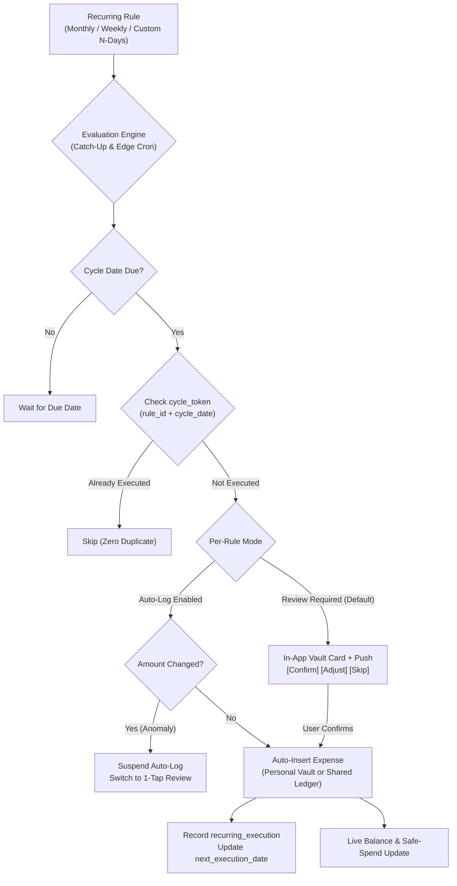

# Architecture & Implementation Plan: Personal & Shared Recurring Bills Engine

**Task Slug:** `recurring-bills-engine`  
**Target Specification:** `docs/PLAN-recurring-bills-engine.md`  
**Status:** ARCHITECTURAL SPECIFICATION & PLAN (Pending User Approval)  
**Date:** 2026-10-31  
**App:** RoomMate (Student Living & Shared Expense Platform)  
**Safety Status:** Isolated Staging Only. Production database (`pbzaaskftrmnvocczhat`) is **100% UNTOUCHED**.

---

## 1. Executive Summary & Objective

In shared flats, hostels, and student accommodations, individual students and flatmates face predictable, recurring expenses (e.g. rent, mess, mobile recharge, Wi-Fi, maid, gym, OTT subscriptions). Currently, students must remember and manually type these expenses every single month.

This engine introduces an **Automated, Idempotent Recurring Bills System** spanning:
1. **Personal Vault Recurring Expenses:** Private to the individual student (100% isolated to `auth.uid()`).
2. **Shared Room Recurring Expenses:** Flatmate bills (Wi-Fi, maid, water cans) integrating with the V2 integer-paise financial engine.
3. **1-Tap Review by Default:** Eliminates manual typing while giving students full control over fluctuating bills, with an optional **per-rule Auto-Log toggle** for fixed subscriptions.



---

## 2. Core Approved Product Decisions

### Q1 — Rule Types & Frequency Intervals
- **Monthly Schedules:**
  - Fixed Day of Month (`day_of_month`: 1 to 31).
  - Last Day of Month handling (e.g. February 28/29, April 30, or 31).
- **Weekly Schedules:**
  - Day of Week (`day_of_week`: 0=Sunday through 6=Saturday).
- **Custom Intervals:**
  - Every $N$ days (e.g. Jio/Airtel 28-day data recharge).
  - Every $N$ weeks / months.
- **Rule Lifecycle:**
  - `start_date` (required YYYY-MM-DD).
  - `end_date` (optional, auto-completes rule when reached).
  - `status`: `ACTIVE`, `PAUSED`, `COMPLETED`.

### Q2 — Notification Architecture (In-App + FCM Push)
- **In-App Vault Banner:** High-visibility actionable card at the top of the Personal Vault (or Room Ledger) on the due date.
- **FCM Push Notification:** Dispatched via Supabase Edge Function `send-push` respecting user device tokens and notification permissions.
- **Anti-Spam Deduplication:** Notification history is checked before dispatching; at most 1 push notification per recurring cycle per rule.

### Q3 — Review-First Default & Per-Rule Auto-Log
- **Default Policy:** All newly created recurring rules default to `auto_log = false` (Review Before Logging).
- **Explicit Per-Rule Setting:** Users can opt-in to `auto_log = true` strictly per bill (e.g., enable for fixed ₹199 Spotify, but keep disabled for fluctuating ₹500–₹800 electricity).
- **Anomaly Suspension:** If an auto-logged rule experiences an unexpected amount or frequency change, Auto-Log is automatically suspended to prevent incorrect ledger writes.

---

## 3. Database Schema & RLS Architecture (Isolated Staging)

### 3.1 `public.recurring_expense_rules`
Stores the recurring subscription definitions.

```sql
CREATE TYPE public.recurring_frequency_type AS ENUM ('MONTHLY', 'WEEKLY', 'CUSTOM_INTERVAL');
CREATE TYPE public.recurring_rule_status AS ENUM ('ACTIVE', 'PAUSED', 'COMPLETED');
CREATE TYPE public.recurring_scope_type AS ENUM ('PERSONAL', 'SHARED');

CREATE TABLE public.recurring_expense_rules (
    id UUID PRIMARY KEY DEFAULT gen_random_uuid(),
    user_id UUID NOT NULL REFERENCES auth.users(id) ON DELETE CASCADE,
    room_id UUID REFERENCES public.rooms(id) ON DELETE CASCADE,
    scope public.recurring_scope_type NOT NULL DEFAULT 'PERSONAL',
    
    title TEXT NOT NULL CHECK (char_length(trim(title)) > 0),
    amount NUMERIC(12, 2) NOT NULL CHECK (amount > 0),
    category TEXT NOT NULL,
    notes TEXT,
    
    -- Frequency Definition
    frequency public.recurring_frequency_type NOT NULL,
    day_of_month SMALLINT CHECK (day_of_month BETWEEN 1 AND 31),
    is_last_day_of_month BOOLEAN NOT NULL DEFAULT false,
    day_of_week SMALLINT CHECK (day_of_week BETWEEN 0 AND 6),
    interval_count INT CHECK (interval_count > 0),
    interval_unit TEXT CHECK (interval_unit IN ('DAYS', 'WEEKS', 'MONTHS')),
    
    -- Schedule Boundaries
    start_date DATE NOT NULL,
    end_date DATE,
    next_execution_date DATE NOT NULL,
    last_executed_at TIMESTAMPTZ,
    
    -- Execution Policy
    auto_log BOOLEAN NOT NULL DEFAULT false,
    status public.recurring_rule_status NOT NULL DEFAULT 'ACTIVE',
    
    -- Shared Room Split configuration (only when scope = 'SHARED')
    split_method TEXT CHECK (split_method IN ('EQUAL', 'EXACT', 'PERCENTAGE', 'SHARES')),
    split_participant_ids UUID[] DEFAULT '{}',
    custom_split_values JSONB DEFAULT '{}',
    
    created_at TIMESTAMPTZ NOT NULL DEFAULT now(),
    updated_at TIMESTAMPTZ NOT NULL DEFAULT now()
);
```

### 3.2 `public.recurring_expense_executions` (Idempotency Ledger)
Guarantees strict zero-duplicate execution.

```sql
CREATE TYPE public.recurring_execution_status AS ENUM (
    'PENDING_REVIEW',
    'AUTO_LOGGED',
    'MANUALLY_CONFIRMED',
    'SKIPPED'
);

CREATE TABLE public.recurring_expense_executions (
    id UUID PRIMARY KEY DEFAULT gen_random_uuid(),
    rule_id UUID NOT NULL REFERENCES public.recurring_expense_rules(id) ON DELETE CASCADE,
    cycle_date DATE NOT NULL, -- The scheduled due date (e.g. 2026-11-01)
    
    status public.recurring_execution_status NOT NULL DEFAULT 'PENDING_REVIEW',
    amount NUMERIC(12, 2) NOT NULL,
    
    -- Link to resulting entry
    generated_personal_expense_id UUID REFERENCES public.personal_expenses(id) ON DELETE SET NULL,
    generated_shared_expense_id UUID REFERENCES public.shared_expenses(id) ON DELETE SET NULL,
    
    executed_at TIMESTAMPTZ,
    reviewed_by UUID REFERENCES auth.users(id),
    created_at TIMESTAMPTZ NOT NULL DEFAULT now(),
    
    -- CRITICAL IDEMPOTENCY CONSTRAINT: At most 1 execution attempt per rule per cycle date
    CONSTRAINT uq_rule_cycle_date UNIQUE (rule_id, cycle_date)
);
```

### 3.3 Strict Row Level Security (RLS) Isolation
1. **Personal Recurring Rules (`scope = 'PERSONAL'`):**
   - Strictly isolated to `auth.uid() = user_id`.
   - Invisible to roommates and superadmins.
2. **Shared Recurring Rules (`scope = 'SHARED'`):**
   - Accessible only to validated active members of `room_id` via `is_room_member(room_id, auth.uid())`.
   - Modifiable only by the creator or active room admin.

---

## 4. Idempotent Execution & Calculation Algorithms

### 4.1 Next Execution Date Calculator
```ts
export function computeNextExecutionDate(
  frequency: 'MONTHLY' | 'WEEKLY' | 'CUSTOM_INTERVAL',
  fromDate: Date,
  options: {
    dayOfMonth?: number;
    isLastDayOfMonth?: boolean;
    dayOfWeek?: number;
    intervalCount?: number;
    intervalUnit?: 'DAYS' | 'WEEKS' | 'MONTHS';
  }
): string // Returns YYYY-MM-DD
```
- **Last Day of Month Logic:** Evaluates `new Date(year, month + 1, 0).getDate()` to correctly match 28th/29th in Feb, 30th in Apr/Jun/Sep/Nov, and 31st elsewhere.
- **Custom Prepaid Cycles:** `fromDate + (intervalCount * 24 * 60 * 60 * 1000)` ensuring 28-day recharges never drift.

### 4.2 Idempotent Database RPC (`execute_recurring_bill_cycle`)
Executes within a Postgres transaction with row-level locks:
1. `SELECT ... FROM recurring_expense_rules WHERE id = p_rule_id FOR UPDATE;`
2. Checks `uq_rule_cycle_date`. If execution row already exists, exits safely (`ALREADY_PROCESSED`).
3. If `auto_log = true` and no amount anomaly detected:
   - Inserts into `public.personal_expenses` (or calls `record_shared_expense_v2`).
   - Marks execution as `AUTO_LOGGED`.
4. If `auto_log = false`:
   - Inserts into `recurring_expense_executions` as `PENDING_REVIEW`.
   - Dispatches FCM push notification.
5. Advances `next_execution_date` to the subsequent cycle.

---

## 5. UI/UX Design: Mobile & Desktop

### 5.1 Personal Vault Hero: "Bills Due for Review"
- Positioned prominently at the top of `PersonalVault.tsx` and `MobileLayout`.
- Displays actionable cards with category icons:
  ```
  ┌─────────────────────────────────────────────────────────────┐
  │ 🗓️ Due Today: Hostel Rent (₹5,000.00)                        │
  │ Scheduled for 1st of every month • Personal Vault          │
  │                                                             │
  │ [✓ Confirm & Log]     [✏️ Adjust Amount]     [✕ Skip Cycle] │
  └─────────────────────────────────────────────────────────────┘
  ```

### 5.2 Recurring Rules Manager Drawer (`RecurringBillsDrawer.tsx`)
- Tab inside Personal Vault: **"Recurring Subscriptions (N Active)"**.
- Quick Add Modal:
  - Title (e.g. "Room Rent", "Mobile Recharge", "Mess Bill").
  - Amount in ₹.
  - Category (Housing, Food, Academics, Tech, Health).
  - Schedule selector:
    - `[Monthly on Day X]`
    - `[Weekly on Monday/etc.]`
    - `[Custom: Every 28 Days]`
  - Start Date & Optional End Date.
  - Switch: **"⚡ Auto-Log without asking"** (with warning: *"Recommended only for fixed bills like Netflix or Rent"*).
- Pause / Resume / Delete controls with audit history.

---

## 6. Offline & Catch-Up Behavior

- **Offline App Open Catch-Up:**
  - Upon app launch or online reconnection, `recurringCatchUpService.ts` executes in the background.
  - Scans for any rule whose `next_execution_date <= CURRENT_DATE` that has no execution record for that cycle date.
  - Generates the pending review card (or enqueues creation into `offlineQueue` if disconnected).
- **Graceful Retries:** Network timeouts during synchronization do not generate duplicate rows due to the `uq_rule_cycle_date` database constraint.

---

## 7. Phased Implementation Roadmap

| Phase | Deliverable | Description | Tests |
| :--- | :--- | :--- | :--- |
| **Phase 1** | Mathematical Engine & Schedule Parser | Pure TypeScript utilities for interval calculation, next-date projection, and last-day-of-month logic. | `scheduleCalculator.test.ts` |
| **Phase 2** | Database Migrations & RLS Policies | Staging migration for `recurring_expense_rules` and `recurring_expense_executions` with owner-only RLS and RPC idempotency locks. | `recurringRulesRls.test.ts` |
| **Phase 3** | Client Synchronization & Catch-Up Service | Local-first catch-up evaluator, offline queue integration, and push notification dispatch. | `recurringCatchUpService.test.ts` |
| **Phase 4** | Mobile & Web UI Components | `RecurringBillsDrawer.tsx`, `PendingBillsBanner.tsx`, and Quick Rule Creator Modal in Personal Vault & Room Ledger. | UI Component verification |
| **Phase 5** | End-to-End Adversarial Tests | Verification of auto-log anomaly suspension, duplicate submission protection, and offline replay. | `recurringFullCycle.test.ts` |

---

## 8. Verification & Acceptance Criteria

1. **Idempotency Invariant:** Running the execution scheduler 10 times consecutively for the same cycle date produces exactly **1** expense row.
2. **Privacy Invariant:** A student's personal recurring rent/bills are 100% invisible to roommates, admins, and unauthenticated callers.
3. **Anomaly Suspension:** If a rule's amount changes, Auto-Log must suspend and require 1-Tap confirmation.
4. **Zero Production Risk:** Production database (`pbzaaskftrmnvocczhat`) remains strictly untouched.
5. **Quality Gates:** 0 Oxlint errors/warnings, clean `tsc -b`, and 100% passing Vitest suite.
