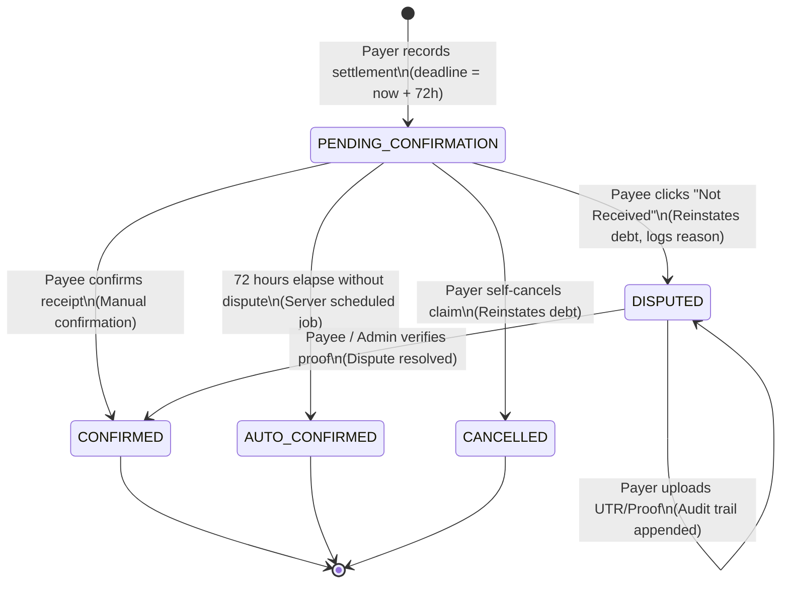

# Architecture & Specification: Recipient Settlement Confirmation Workflow

**Document ID:** `PLAN-settlement-confirmation-workflow.md`  
**Status:** Pre-Implementation Specification & Design Review  
**Author:** Antigravity AI  
**Target Environment:** Isolated Staging (`ycredqiiwdbrjzqeczio`)  
**Production Gate:** `pbzaaskftrmnvocczhat.supabase.co` is **LOCKED & STRICTLY UNTOUCHED**  

---

## 1. Executive Summary

This document specifies the architectural model, finite-state machine (FSM), accounting semantics, database constraints, authorization boundaries, and test matrix for **Recipient Settlement Confirmation**.

### Core Business Objectives:
1. **Eliminate Unilateral Settlement Claims:** When a payer claims to have settled a debt (via UPI, Cash, or Bank Transfer), the payment enters a provisional state (`PENDING_CONFIRMATION`) until the payee explicitly confirms or disputes receipt.
2. **Provisional Accounting (Optimistic UI):** The payer's active debt immediately reflects the claimed settlement provisionally (marked with an amber badge and disclaimer), preventing duplicate settlement attempts while alerting the room of unconfirmed funds.
3. **Immutable Dispute Trail:** Disputing a payment immediately reinstates the debt across both Simplified and Pairwise ledgers. The disputed record is never deleted or overwritten, maintaining a tamper-evident audit history.
4. **72-Hour Inactivity Window:** Pending settlements automatically confirm after 72 hours if no dispute is raised, preceded by an in-app reminder to the payee at 24 hours.

---

## 2. State-Transition Model

### 2.1 Finite State Diagram



### 2.2 Permitted State Transitions Table

| Source State | Destination State | Permitted Actor | Conditions & Invariants | Financial Effect |
| :--- | :--- | :--- | :--- | :--- |
| *(None)* | `PENDING_CONFIRMATION` | **Payer** (Roommate who sent funds) | `amount > 0`, `amount <= outstanding_debt`, `payer != payee`, both in room. | Deducts amount from **Provisional Balance**; Confirmed Balance remains unchanged. |
| `PENDING_CONFIRMATION` | `CONFIRMED` | **Payee** (Roommate who received funds) | Current timestamp < `confirmation_deadline` OR manual override by payee. | Moves amount from Provisional to **Confirmed Balance**. Permanent reduction. |
| `PENDING_CONFIRMATION` | `DISPUTED` | **Payee** only | Must provide non-empty dispute reason. Row locked with `FOR UPDATE`. | **Reverses provisional deduction**. Debt reinstated on Simplified & Pairwise ledgers. |
| `PENDING_CONFIRMATION` | `CANCELLED` | **Payer** only | Settlement has not been confirmed or disputed yet. | **Reverses provisional deduction**. Debt reinstated. Marked as cancelled by payer. |
| `PENDING_CONFIRMATION` | `AUTO_CONFIRMED` | **System / Server Cron** | `clock_timestamp() >= confirmation_deadline` AND `status = 'PENDING_CONFIRMATION'`. | Moves amount from Provisional to **Confirmed Balance** (`method = 'AUTOMATIC'`). |
| `DISPUTED` | `DISPUTED` | **Payer** | Payer submits evidence (bank UTR, screenshot URL). Status remains `DISPUTED`. | Zero balance change. Audit metadata updated with evidence. |
| `DISPUTED` | `CONFIRMED` | **Payee** or **Room Admin** | Payee acknowledges received funds after reviewing submitted evidence. | Moves amount from Disputed to **Confirmed Balance** (`method = 'ADMIN_RESOLUTION'`). |

### 2.3 Forbidden Transitions (Strictly Blocked by Database Constraints & RPC)
* ❌ `CONFIRMED` $\to$ `DISPUTED` (Confirmed financial transactions cannot be unilaterally disputed by client).
* ❌ `AUTO_CONFIRMED` $\to$ `DISPUTED` (Expired window cannot be disputed through standard path; requires superadmin dispute ticket).
* ❌ `DISPUTED` $\to$ `AUTO_CONFIRMED` (A disputed payment is halted permanently from auto-confirmation).
* ❌ `CANCELLED` $\to$ Any State (Terminal state).

---

## 3. Financial Accounting Treatment & Dual-Ledger Invariants

### 3.1 Dual-Balance Definitions

To prevent balance ambiguity between roommates:
1. **Confirmed Net Balance ($\text{Net}_{\text{confirmed}}$):**
   $$\text{Net}_{\text{confirmed}}(u) = \sum \text{Paid} - \sum \text{Share} + \sum \text{Settled}_{\text{confirmed/auto}}^{\text{sent}} - \sum \text{Settled}_{\text{confirmed/auto}}^{\text{rcvd}}$$
2. **Provisional Net Balance ($\text{Net}_{\text{provisional}}$):**
   $$\text{Net}_{\text{provisional}}(u) = \text{Net}_{\text{confirmed}}(u) + \sum \text{Settled}_{\text{pending}}^{\text{sent}} - \sum \text{Settled}_{\text{pending}}^{\text{rcvd}}$$

### 3.2 Status Accounting Matrix

| Settlement Status | Pairwise Audit Ledger Inclusion | Simplified Debt Deduction | Outstanding Debt Impact | UI Indicator |
| :--- | :--- | :--- | :--- | :--- |
| `PENDING_CONFIRMATION` | Included as provisional bilateral transfer | Deducted provisionally from net balance | **Provisional reduction** (Disclosed) | 🟡 Amber Badge: *"Pending Roommate Confirmation"* |
| `CONFIRMED` | Included as definitive bilateral transfer | Permanently settled in min-cash-flow | **Permanent reduction** | 🟢 Green Badge: *"Confirmed by Payee"* |
| `AUTO_CONFIRMED` | Included as definitive bilateral transfer | Permanently settled in min-cash-flow | **Permanent reduction** | 🟢 Emerald Badge: *"Auto-Confirmed (72h Policy)"* |
| `DISPUTED` | Retained in audit history with reason | **Zero deduction** (Excluded from settlement sum) | **No reduction** (Debt restored) | 🔴 Red Badge: *"Disputed: Payment Not Received"* |
| `CANCELLED` | Retained in audit history | **Zero deduction** | **No reduction** (Debt restored) | ⚪ Gray Badge: *"Cancelled by Payer"* |

### 3.3 Partial Payments & Cumulative Oversettlement Invariant

Multiple pending and confirmed settlements are permitted against the same debt (e.g., paying ₹250 of ₹500 today, and ₹150 tomorrow).

**The Invariant:**
$$\sum \text{Settlements}_{\text{confirmed}}(A \to B) + \sum \text{Settlements}_{\text{pending}}(A \to B) \le \text{Gross Obligation}(A \to B)$$

If Payer $A$ owes ₹500:
* Payer logs ₹300 $\to$ `PENDING_CONFIRMATION` (Remaining provisional payable: ₹200).
* Payer attempts to log ₹250 $\to$ **REJECTED with `OVERSETTLEMENT_EXCEEDS_DEBT`** (Max allowable is ₹200).
* Payee disputes the ₹300 $\to$ `DISPUTED` (Remaining provisional payable restores to ₹500).

---

## 4. Database Schema, Constraints & Concurrency Protections

### 4.1 Schema Migration (`public.settlement_payments`)

```sql
-- Add status and audit tracking columns
ALTER TABLE public.settlement_payments
  ADD COLUMN IF NOT EXISTS status TEXT NOT NULL DEFAULT 'PENDING_CONFIRMATION'
    CHECK (status IN ('PENDING_CONFIRMATION', 'CONFIRMED', 'AUTO_CONFIRMED', 'DISPUTED', 'CANCELLED')),
  ADD COLUMN IF NOT EXISTS confirmation_deadline TIMESTAMPTZ NOT NULL 
    DEFAULT (clock_timestamp() + INTERVAL '72 hours'),
  ADD COLUMN IF NOT EXISTS reminder_sent_at TIMESTAMPTZ,
  ADD COLUMN IF NOT EXISTS confirmed_at TIMESTAMPTZ,
  ADD COLUMN IF NOT EXISTS confirmed_by UUID REFERENCES public.profiles(id),
  ADD COLUMN IF NOT EXISTS confirmation_method TEXT 
    CHECK (confirmation_method IN ('MANUAL', 'AUTOMATIC', 'ADMIN_RESOLUTION')),
  ADD COLUMN IF NOT EXISTS disputed_at TIMESTAMPTZ,
  ADD COLUMN IF NOT EXISTS disputed_by UUID REFERENCES public.profiles(id),
  ADD COLUMN IF NOT EXISTS dispute_reason TEXT,
  ADD COLUMN IF NOT EXISTS evidence_utr TEXT,
  ADD COLUMN IF NOT EXISTS evidence_url TEXT,
  ADD COLUMN IF NOT EXISTS cancelled_at TIMESTAMPTZ;

-- Indices for rapid scheduled job execution and room feed filtering
CREATE INDEX IF NOT EXISTS idx_settlements_pending_deadline 
  ON public.settlement_payments(confirmation_deadline) 
  WHERE status = 'PENDING_CONFIRMATION';

CREATE INDEX IF NOT EXISTS idx_settlements_room_status 
  ON public.settlement_payments(room_id, status);
```

### 4.2 Security Definer RPCs & Concurrency Row Locking

To prevent Time-of-Check-to-Time-of-Use (TOCTOU) race conditions (e.g. payee disputing at the exact millisecond auto-confirmation runs):

1. **`confirm_room_settlement_secure(p_settlement_id UUID)`:**
   - Acquires row lock: `SELECT * FROM settlement_payments WHERE id = p_settlement_id FOR UPDATE;`
   - Validates caller is recipient: `IF auth.uid() <> v_settlement.payee_id THEN RAISE EXCEPTION 'ACCESS_DENIED';`
   - Validates status: `IF v_settlement.status <> 'PENDING_CONFIRMATION' THEN RAISE EXCEPTION 'INVALID_TRANSITION';`
   - Updates: `status = 'CONFIRMED'`, `confirmed_at = clock_timestamp()`, `confirmed_by = auth.uid()`, `confirmation_method = 'MANUAL'`.
   - Dispatches in-app notification to Payer: *"Bob confirmed your ₹500 settlement."*

2. **`dispute_room_settlement_secure(p_settlement_id UUID, p_reason TEXT)`:**
   - Acquires row lock: `SELECT * FROM settlement_payments WHERE id = p_settlement_id FOR UPDATE;`
   - Validates caller is recipient: `IF auth.uid() <> v_settlement.payee_id THEN RAISE EXCEPTION 'ACCESS_DENIED';`
   - Validates status: `IF v_settlement.status <> 'PENDING_CONFIRMATION' THEN RAISE EXCEPTION 'INVALID_TRANSITION';`
   - Updates: `status = 'DISPUTED'`, `disputed_at = clock_timestamp()`, `disputed_by = auth.uid()`, `dispute_reason = trim(p_reason)`.
   - Dispatches high-priority in-app notification to Payer: *"Bob disputed your settlement: [Reason]. Please provide bank UTR proof."*

3. **`process_settlement_auto_confirmations()` (Scheduled Job):**
   - Batches pending records where `confirmation_deadline <= clock_timestamp()`.
   - Acquires row locks using `FOR UPDATE SKIP LOCKED`.
   - Transitions to `status = 'AUTO_CONFIRMED'`, `confirmation_method = 'AUTOMATIC'`.
   - Dispatches notifications to both Payer and Payee.

---

## 5. Automated Test Matrix Plan

We will create `src/test/v2-financial-engine/settlementConfirmationWorkflow.test.ts` covering 10 rigorous scenarios:

1. **TC-1: Settlement Creation Invariants:** Verifies initial status is `PENDING_CONFIRMATION`, deadline is set to $+72\text{h}$, and provisional balance reduces while confirmed balance stays unmutated.
2. **TC-2: Manual Payee Confirmation:** Verifies payee can confirm, status moves to `CONFIRMED`, method is `MANUAL`, and confirmed balance updates.
3. **TC-3: Dispute Reversal Semantics:** Verifies payee dispute moves status to `DISPUTED`, restores full debt on Simplified and Pairwise ledgers, and preserves dispute reason.
4. **TC-4: Authorization Boundaries:** Verifies that third parties (unrelated room members) cannot confirm, dispute, or cancel another member's settlement.
5. **TC-5: Payer Self-Cancellation:** Verifies payer can cancel their own pending settlement claim, restoring their debt.
6. **TC-6: Cumulative Partial Settlements & Oversettlement Clamping:** Verifies that two pending partial settlements whose sum exceeds the debt are rejected.
7. **TC-7: Race Condition Protection:** Simulates concurrent payee dispute and payee confirmation; proves exactly one succeeds and the other receives `INVALID_TRANSITION`.
8. **TC-8: 72-Hour Auto-Confirmation Job:** Simulates clock advancement past 72h; proves eligible pending records transition to `AUTO_CONFIRMED`.
9. **TC-9: Near-Deadline Dispute Invariant:** Proves a dispute executed at 71h 59m prevents subsequent auto-confirmation job from triggering.
10. **TC-10: Dual-Ledger Zero-Sum Reconciliation:** Proves that across all state transitions (`PENDING` $\to$ `DISPUTED` $\to$ `CONFIRMED`), the room's total net balance strictly equals ₹0.00 with zero paise drift.

---

## 6. Implementation Rollout Strategy

1. **Staging Migration Only:** All DDL and functions will be encapsulated in `supabase/migrations/20261005180000_recipient_settlement_confirmation.sql`.
2. **Production Safety Assert:** Any migration or execution script will enforce `assertNotProduction` blocking `pbzaaskftrmnvocczhat`.
3. **Feature Branch:** Work proceeds on `feat/phase10-roommate-split-and-vault-rls` without affecting `main`.

