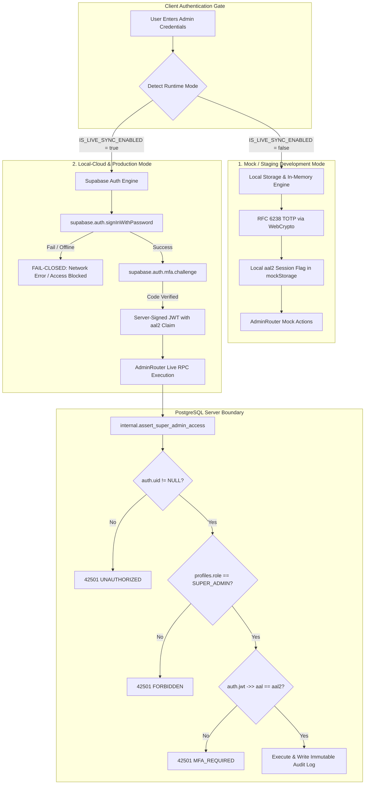

# Implementation Specification & Adversarial Test Plan: SuperAdmin Security & Zero-Trust Hardening

**Document ID:** `docs/PLAN-superadmin-audit-fix.md`  
**Status:** SPECIFICATION & TEST PLAN APPROVED — PENDING IMPLEMENTATION AUTHORIZATION  
**Execution Constraint:** **NO database migrations, NO production role changes, NO production data alterations, and NO deployments may be executed until explicitly approved.**

---

## 1. Executive Summary & Security Objectives

Following the comprehensive audit of the SuperAdmin platform (`/admin`), this document specifies the architectural controls, code modifications, adversarial test suite, and emergency recovery runbook required to establish **Zero-Trust Parity** across the entire stack.

### Key Objectives
1. **Total Elimination of Backdoors & Unauthenticated Escalation**:
   - Sever all automatic role promotions in client views.
   - Eliminate hardcoded fallback keys (`'master_admin_key_2026'`).
   - Remove unauthenticated MFA resets from the challenge view.
2. **Tri-Mode Authentication Architecture**:
   - Strict physical and logical boundary between **Mock Mode**, **Local Supabase Mode**, and **Production Cloud Mode**.
   - Zero leakage of mock secrets or mock credentials into cloud environments.
   - Fail-closed security: Network drops or Supabase Auth outages must **never** degrade to mock authentication or bypass MFA.
3. **Server-Authoritative Role & Assurance Level (AAL2)**:
   - Client state is purely presentational; the database is the singular authority.
   - Any sensitive RPC requires an active cryptographic session (`auth.uid()`) and authentic `aal2` JWT assurance claims.
4. **Adversarial Negative Testing**:
   - Complete Vitest suite testing role tampering, brute-force bypass, session hijacking, network loss, and expired token rejections.
5. **Auditable Emergency Database Recovery Runbook**:
   - Secure procedure for manual database-level break-glass recovery with full audit logging and no public endpoints.

---

## 2. Tri-Mode Authentication Architecture Specification

To satisfy the isolation mandate, the application enforces three mutually exclusive operational tiers:



### Mode Boundary Rules
| Dimension | Mode 1: Mock / Local Offline | Mode 2: Local Supabase Cloud | Mode 3: Production Cloud |
| :--- | :--- | :--- | :--- |
| **Sync Flag** | `IS_LIVE_SYNC_ENABLED = false` | `IS_LIVE_SYNC_ENABLED = true` | `IS_LIVE_SYNC_ENABLED = true` |
| **Backend Target** | In-browser `mockStorage` | `localhost:54321` (Docker) | Production Supabase Instance |
| **Identity Authority** | Local storage users list | `auth.users` + `public.profiles` | `auth.users` + `public.profiles` |
| **MFA Verification** | In-browser WebCrypto RFC 6238 | Supabase Auth MFA (`aal2` JWT) | Supabase Auth MFA (`aal2` JWT) |
| **Network Failure Behavior**| N/A | **Fail Closed** (Blocks Access) | **Fail Closed** (Blocks Access) |
| **RPC Execution** | In-memory mock mutations | Postgres RPC via Supabase SDK | Postgres RPC via Supabase SDK |
| **Isolation Barrier** | Mock state can never issue Supabase tokens | Local tokens cannot access Prod | Production tokens isolated |

> [!CAUTION]
> **Zero Fallback In Cloud Mode**: If `IS_LIVE_SYNC_ENABLED === true` and a network error, timeout, or Supabase service interruption occurs during admin login or MFA challenge, the app **must throw a blocking error** and halt. It is strictly forbidden to fall back to `mockStorage` or bypass MFA when cloud sync is enabled.

---

## 3. Detailed Component Modifications Specification

### 3.1 `src/components/admin/AdminLoginView.tsx`

#### A. Elimination of Auto-Promotion
- **Target Lines:** [L129–L146](file:///c:/Users/ASUS/Downloads/student%20expense%20app/src/components/admin/AdminLoginView.tsx#L129-L146)
- **Current Behavior:** Automatically promotes any unregistered or resident email to `SUPER_ADMIN` and marks `isNewPasswordSetup = true`.
- **New Specification:**
  - Query existing user from `allUsers` and `db.getState().users`.
  - Check authorization:
    ```typescript
    const isAuthorized = matched && matched.role === 'SUPER_ADMIN' && !matched.isSuspended;
    if (!isAuthorized) {
      // Record probe in intrusion detection service
      const probe = recordFailedAdminProbe();
      if (probe.shouldAlertAdmin) {
        dispatchIntrusionAlert(cleanEmail, probe.failedAttempts);
      }
      setError('Access Denied: You do not have platform administrator privileges.');
      setIsLoading(false);
      return;
    }
    ```
  - **No user provisioning or role mutation** in the client login component.

#### B. Removal of MFA Bypass Button
- **Target Lines:** [L736–L745](file:///c:/Users/ASUS/Downloads/student%20expense%20app/src/components/admin/AdminLoginView.tsx#L736-L745) & [L371–L388](file:///c:/Users/ASUS/Downloads/student%20expense%20app/src/components/admin/AdminLoginView.tsx#L371-L388)
- **Current Behavior:** `"Re-scan QR / Reset Authenticator"` button calls `handleResetMfaAndReEnroll` directly during `MFA_CHALLENGE`, allowing an attacker to overwrite the admin's 2FA secret without verification.
- **New Specification:**
  - Delete `handleResetMfaAndReEnroll` and remove the reset button entirely from `MFA_CHALLENGE`.
  - The only allowed recovery path is clicking `"Lost device? Use Recovery Code"`, transitioning to `step === 'RECOVERY_CODE'`.
  - Re-enrollment of a new authenticator device is only accessible from inside the authenticated console under `AdminSecurity.tsx` after satisfying **Level 3 Step-Up Authentication** (or through verified one-time recovery code consumption).

#### C. Cloud Supabase Auth Bridging
- In cloud mode (`IS_LIVE_SYNC_ENABLED === true`):
  1. On credentials submit: Call `supabase.auth.signInWithPassword({ email, password })`. If invalid or unconfirmed, return error.
  2. On MFA challenge: Call `supabase.auth.mfa.challenge({ factorId })` followed by `supabase.auth.mfa.verify(...)` to mint a genuine `aal2` session token.
  3. If offline or mock mode: Use local WebCrypto hash and RFC 6238 TOTP engine.

---

### 3.2 `src/components/admin/pages/AdminSecurity.tsx`

#### A. Elimination of Hardcoded Master Key
- **Target Lines:** [L369–L374](file:///c:/Users/ASUS/Downloads/student%20expense%20app/src/components/admin/pages/AdminSecurity.tsx#L369-L374)
- **Current Behavior:** Accepts `currentPassword === 'master_admin_key_2026'` to bypass hash check.
- **New Specification:**
  - Remove `'master_admin_key_2026'` completely.
  - Require strict cryptographic verification:
    ```typescript
    const currentHash = await hashMasterPassword(currentPassword);
    if (currentHash !== settings.masterPasswordHash) {
      setChangePasswordError('Current Master Security Key is incorrect.');
      return;
    }
    ```

#### B. Audit Logging for Security Setting Changes
- Every rotation of the master security key, generation of recovery codes, or device revocation must write an audit record with `actorId`, `targetEntityId`, timestamp, and client fingerprint.

---

### 3.3 `src/App.tsx`

#### A. Removal of Client-Side Role Forgery
- **Target Lines:** [L445–L447](file:///c:/Users/ASUS/Downloads/student%20expense%20app/src/App.tsx#L445-L447)
- **Current Behavior:**
  ```typescript
  if (currentUser.role === 'SUPER_ADMIN' && matched.role !== 'SUPER_ADMIN') {
    matched.role = 'SUPER_ADMIN'; // OVERWRITES REMOTE PROFILE
  }
  setCurrentUser(matched);
  ```
- **New Specification:**
  - Delete the role override completely.
  - If `matched.role !== 'SUPER_ADMIN'` and `activeTab === 'admin'`, immediately force `activeTab = 'dashboard'` and notify the user with an unauthorized access toast.
  - Remote database state is immutable from the client.

---

### 3.4 `src/lib/auth/superAdminSecurityService.ts`

#### A. Persistent Anti-Brute-Force Rate Limiting
- **Target Lines:** [L74–L75](file:///c:/Users/ASUS/Downloads/student%20expense%20app/src/lib/auth/superAdminSecurityService.ts#L74-L75) & [L336–L366](file:///c:/Users/ASUS/Downloads/student%20expense%20app/src/lib/auth/superAdminSecurityService.ts#L336-L366)
- **Current Behavior:** In-memory variables `memoryFailedAttempts` and `memoryLockoutUntil` are reset on browser reload (`F5`).
- **New Specification:**
  - Persist rate-limit state in browser storage using key: `roommate_superadmin_auth_ratelimit`.
  - Payload structure:
    ```typescript
    interface PersistedRateLimitState {
      failedAttempts: number;
      lockedUntilTimestamp: number | null;
      lastAttemptAt: number;
    }
    ```
  - `checkRateLimit()` reads from persistent storage and enforces the 15-minute window even if the tab is reloaded, closed, or duplicated.
  - Clean up lockout only after wall-clock time exceeds `lockedUntilTimestamp`.

#### B. Plaintext Secret Purge
- After initial QR code scanning and confirmation, do not persist the raw `totpSecret` string in unencrypted `localStorage` when running in cloud mode. Rely on Supabase Auth MFA factor IDs.

---

### 3.5 `src/components/admin/AdminRouter.tsx`

#### A. Dynamic Route Display on Access Denied
- **Target Line:** [L782](file:///c:/Users/ASUS/Downloads/student%20expense%20app/src/components/admin/AdminRouter.tsx#L782)
- **Current Behavior:** Hardcodes `/admin/system-health` in the error description.
- **New Specification:** Dynamically inject `window.location.pathname` or current route name.

#### B. Cache Clear Warning
- **Target Lines:** [L760–L771](file:///c:/Users/ASUS/Downloads/student%20expense%20app/src/components/admin/AdminRouter.tsx#L760-L771)
- Prompt with confirmation dialog informing the administrator that clearing the local cache will log them out of their current session.

---

## 4. Emergency SuperAdmin Recovery Procedure (Break-Glass Runbook)

> [!IMPORTANT]
> **Emergency Recovery Guarantees**:
> - NO public recovery endpoints, query parameters, or backdoor keys.
> - Requires verified, direct console/SQL access to the Supabase PostgreSQL database.
> - Completely auditable; every emergency intervention creates an immutable record in `public.security_audit_logs`.

### 4.1 Step 1: Identity & Credentials Verification
Before initiating break-glass procedures:
1. Verify the identity of the engineer requesting emergency access through out-of-band communication (cryptographic signature or verified organization channel).
2. Confirm that the target user already has a valid user account in `auth.users` (created via official email signup).

### 4.2 Step 2: Database Break-Glass SQL Execution
Run the following parameterized script directly in the Supabase Cloud SQL Editor or via authenticated `psql` session:

```sql
-- ============================================================================
-- BREAK-GLASS RUNBOOK: Verified SuperAdmin Emergency Role Assignment
-- Target: Supabase Cloud PostgreSQL
-- Author: Infrastructure Lead / Security Auditor
-- Note: Replace 'target_admin@organization.com' with verified user's email
-- ============================================================================

DO $$
DECLARE
  v_user_id UUID;
  v_user_email TEXT := 'target_admin@organization.com';
  v_audit_id UUID := gen_random_uuid();
BEGIN
  -- 1. Locate authenticated user
  SELECT id INTO v_user_id
  FROM auth.users
  WHERE email = v_user_email;

  IF v_user_id IS NULL THEN
    RAISE EXCEPTION 'BREAK_GLASS_FAILED: No auth.users entry found for email %', v_user_email;
  END IF;

  -- 2. Promote profile to SUPER_ADMIN
  -- Uses authorized service_role context or internal trigger override
  UPDATE public.profiles
  SET 
    role = 'SUPER_ADMIN',
    is_suspended = false,
    updated_at = now()
  WHERE id = v_user_id;

  -- 3. Reset lockout on security settings and enforce mandatory MFA re-enrollment
  INSERT INTO public.superadmin_security_settings (
    user_id,
    totp_enrolled,
    mfa_required,
    failed_mfa_attempts,
    locked_until,
    last_step_up_level,
    updated_at
  )
  VALUES (
    v_user_id,
    false,
    true,
    0,
    NULL,
    1,
    now()
  )
  ON CONFLICT (user_id) DO UPDATE SET
    failed_mfa_attempts = 0,
    locked_until = NULL,
    updated_at = now();

  -- 4. Record Immutable Security Audit Event
  INSERT INTO public.security_audit_logs (
    id,
    actor_id,
    event_type,
    result,
    target_entity,
    target_entity_id,
    metadata,
    created_at
  )
  VALUES (
    v_audit_id,
    NULL, -- Direct database admin
    'BREAK_GLASS_SUPERADMIN_PROMOTION',
    'SUCCESS',
    'PROFILES',
    v_user_id::text,
    jsonb_build_object(
      'target_email', v_user_email,
      'reason', 'Emergency platform access recovery',
      'executed_by', current_user,
      'timestamp', now()
    ),
    now()
  );

  RAISE NOTICE 'BREAK_GLASS_SUCCESS: User % (%) successfully promoted to SUPER_ADMIN.', v_user_email, v_user_id;
END $$;
```

### 4.3 Step 3: Emergency MFA Reset (If Device Lost)
If the administrator lost their MFA device and recovery codes:
```sql
-- Remove verified MFA factors from auth.mfa_factors for this user
DELETE FROM auth.mfa_factors
WHERE user_id = (SELECT id FROM auth.users WHERE email = 'target_admin@organization.com');

-- Reset superadmin security settings so next login triggers fresh mandatory QR enrollment
UPDATE public.superadmin_security_settings
SET 
  totp_enrolled = false,
  recovery_codes_configured = false,
  recovery_codes_remaining = 0,
  updated_at = now()
WHERE user_id = (SELECT id FROM auth.users WHERE email = 'target_admin@organization.com');
```

---

## 5. Comprehensive Adversarial Test Plan

We establish a dedicated test suite: `src/components/admin/superAdminSecurityAuditFix.test.ts`.

### 5.1 Adversarial Test Matrix

| Test Suite Section | Vector / Scenario | Injected Condition | Expected Result |
| :--- | :--- | :--- | :--- |
| **1. Unauthenticated Role Escalation** | Arbitrary new email entered in `/admin` | `hacker@evil.com` submitted to `handlePrimaryAuth` | `isAuthorized === false`; user NOT created or promoted in storage; error displayed. |
| | Existing `STUDENT` user entered in `/admin` | `student@campus.edu` submitted to `handlePrimaryAuth` | Access rejected; user's role remains `STUDENT`; intrusion probe recorded. |
| | Suspended SuperAdmin entered in `/admin` | `isSuspended: true` with `role: 'SUPER_ADMIN'` | Access rejected with "Account suspended" error. |
| **2. Backdoor Key Invalidation** | Password change using `'master_admin_key_2026'` | Injected `currentPassword = 'master_admin_key_2026'` | Rejected with "Current Master Security Key is incorrect"; hash NOT modified. |
| | Password change with correct current password | Valid hash match | Successfully updates `masterPasswordHash` and writes audit log. |
| **3. MFA Bypass Prevention** | Direct reset trigger on MFA challenge | Simulate click on reset during active TOTP challenge | Button absent; reset rejected without verified recovery code. |
| | Invalid TOTP code brute-force (5 attempts) | 5 incorrect 6-digit codes submitted | Trigger 15-minute lockout; remaining attempts decrease from 5 → 0. |
| | Lockout persistence test across reload | Set lockout in persistent storage → simulate page reload (`F5`) | Lockout persists; remaining seconds > 0; authentication blocked. |
| | Valid one-time recovery code consumption | Valid recovery code submitted | Code verified, marked consumed (single-use), session authorized. |
| | Replay of consumed recovery code | Submit already consumed recovery code | Rejected with "Invalid or already consumed recovery code". |
| **4. Cloud Role Authority & State Tampering** | Cloud state sync with modified local role | Local state: `SUPER_ADMIN`; Cloud state: `STUDENT` | Local state demoted to `STUDENT`; user redirected away from `/admin`. |
| **5. Fail-Closed Network Disconnect** | Network timeout during cloud MFA challenge | `IS_LIVE_SYNC_ENABLED = true`, `supabase.auth.mfa.verify` throws network error | Throws error; halts login; **does NOT fall back** to mock MFA or allow console entry. |
| **6. Expired Session Invalidation** | Expired JWT session verification | JWT with `exp < now()` or revoked session timestamp | Denied access; prompts re-authentication. |

---

## 6. Verification Checklist Before Any Production Changes

- [ ] All 54 existing tests continue to pass (`src/components/admin/*.test.ts`, `superAdminSecurity.test.ts`).
- [ ] New adversarial test suite passes with 100% test assertions (`superAdminSecurityAuditFix.test.ts`).
- [ ] TypeScript check (`tsc -b`) and Vite build (`npm run build`) complete with zero errors.
- [ ] No database migrations executed without explicit user confirmation.
- [ ] No production roles altered.
